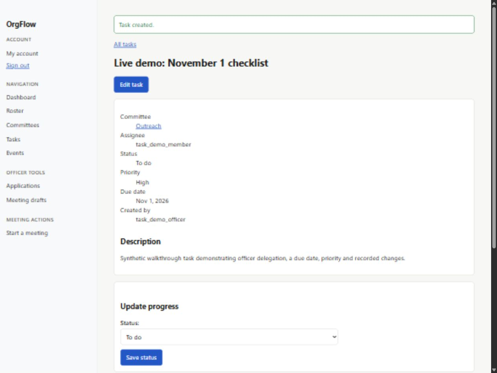

# OrgFlow Individual Contribution Report

Accounts Tasks and Shared Integration

Chau Minh Viet Nguyen | CSE 6324 Advanced Topics in Software Engineering | October 25, 2026

## Contribution summary

My contribution covers Accounts WBS 1.3, Tasks WBS 1.6, the architecture and testing foundation, and the shared safeguards needed to connect my work to the team application. The core implementation and its recorded automated checks are complete within the documented scope. Team review, the actual VM release, owner-run live services and human acceptance remain open for the November 1 target. The reported course deadline is November 10.

## Implemented contribution

Accounts extends the inherited Django account system. The contribution includes Google identity verification and account binding, current-state role/access restrictions, canonical username and nonblank-email uniqueness, role-change history, and recoverable signup and suspension-related access transitions. Password sign-in and registration existed in the inherited prototype; this report does not assign their original authorship to me.

Tasks adds officer creation and delegation, committee-limited visibility, eligible member claiming, due dates, priority, progress updates, search/filtering, counts, pagination, dashboard/committee links and actor history. A member can update their own accessible task; task details and reassignment remain officer/admin actions.

Shared integration connects completed officer-approved meeting reviews to task creation. The preview and import use the same accepted-action snapshot. A unique source key prevents repeated imports from creating duplicate tasks, while version and generation checks stop older forms from overwriting newer decisions.

## Ownership and collaboration

| Responsibility | Contribution boundary |
| --- | --- |
| Chau | Accounts changes, Tasks, scoped audit/recovery and shared integration safeguards; test, architecture and deployment supplements. |
| TJ | Membership administration, roster/profile and related suspension functionality inherited from the team base. |
| Ayomide | Events and attendance functionality integrated into the combined preview. |
| Jack | Meeting AI processing, recording and transcription functionality integrated into the preview. |

I used AI assistance for implementation, review, testing and documentation. The assistance and validation boundaries are recorded on the final page; this report is an individual supplement to the team report.

## Architecture and design rationale

The application uses Django 5.2.17 with django-mongodb-backend 5.2.4 and MongoDB. Views/forms handle HTTP requests and feedback, while task services recheck current access and perform controlled writes. The combined preview also contains the teammate Events and Meetings apps. Production settings and the container release path are separate from development startup.

### Current authorization at the time of the change

The role order is Applicant, Member, Officer and Admin. Committee membership adds a separate visibility boundary. Services reload account and membership state rather than trusting an old page or cached role. Inactive, suspended or unfinished access transitions block task access and assignment. Guessing another committee task ID does not grant access.

### One task document contains state and history

Each task has a version and embedded history. A change writes only when the submitted version still matches the stored version. For example, two pages can both load version 0, but only the first valid update can advance it to version 1; the second receives conflict feedback. The task values, new version and history entry change together in one MongoDB document. This avoids losing another person's update without requiring a multi-document transaction.

Descriptions are limited to 5,000 characters. Long historical values retain a preview, length and SHA-256 fingerprint. A prospective history larger than 8 MiB of BSON is rejected before changing the task. These are bounded records, not an unlimited global audit service.

### Recovery and approved action conversion

Signup records a durable exact-attempt intent before provisioning. Recovery restores only that owned pending attempt; it does not merge accounts, grant a role or delete a reviewed application. Role changes append actor/time/from-to information with their versioned update. Suspension recovery preserves its saved activation state and original reviewer; it is separate from appended role history.

Meeting actions are staged under a generation token before publication. Review records the decision and accepted item intent; imports stay blocked until that review finishes. The importer uses a unique origin key per action. A batch can be retried after interruption, but it is not one transaction across every task.

## Design artifacts and source anchors

[Architecture and external boundaries](https://github.com/aayowole1/Software-Eng/blob/a571daa038b382dabe79a0350c69c56e2b589d15/docs/diagrams/current-architecture.png)

[Task domain and MongoDB storage](https://github.com/aayowole1/Software-Eng/blob/a571daa038b382dabe79a0350c69c56e2b589d15/docs/diagrams/task-domain.png)

[Authorized update and conflict sequence](https://github.com/aayowole1/Software-Eng/blob/a571daa038b382dabe79a0350c69c56e2b589d15/docs/diagrams/task-mutations.png)

The three diagrams describe application snapshot 812d9e6. The later deployment supplement adds the production settings, release/static step and container health/recovery checks. Diagrams show logical Django references; they do not imply SQL foreign-key enforcement in MongoDB.

## Validation and independent review

The results below identify their actual checkpoints. Shared cases overlap between branches and must not be added together as a count of personally authored tests. Automated execution also does not prove my own demonstration, understanding or human peer approval.

| Evidence | Recorded result and scope |
| --- | --- |
| Chau branch CI | 419 tests passed in 78.608 seconds at 3d7d8a7; system and migration-drift checks passed. |
| Combined preview CI | 432 collected, 430 passed and 2 live Deepgram checks skipped in 154.184 seconds at a571daa. |
| Coverage snapshot | Accounts/Tasks: 1,313 of 1,377 statements (95.35%) and 376 of 414 branches (90.82%). Measured before the later deployment files; not whole-project coverage. |
| Release safeguards | 15 production configuration/readiness checks; non-root read-only image; explicit release/static step; no published MongoDB port. |
| Container integration | Private-CA HTTPS, secure cookies/CSRF, permissions, accepted-action import retry, internal SMTP reset, DB outage/readiness and restart/restore passed. |
| Published recovery smoke | 11 seconds for the Chau branch and 10 seconds for the combined preview using a fresh synthetic backup and small test database. |

[Chau published-source CI receipt](https://github.com/aayowole1/Software-Eng/actions/runs/40267968094)

[Combined published-source CI receipt](https://github.com/aayowole1/Software-Eng/actions/runs/40267960647)

### Review and accessibility evidence

Actual Claude static reviews identified issues that Codex investigated and corrected, including signup recovery, stale review/generation behavior and import consistency. Claude's final recorded static read found no remaining blocker in its scoped source snapshot. It did not execute the tests. Independent Codex agents reviewed later deployment/SMTP/isolation instructions; no new Claude review of those later files is claimed.

Recorded synthetic browser checks covered task screens, member progress/claiming, import retry and keyboard navigation. The retained desktop task scan states reported zero axe violations and no incomplete checks; mobile glyph checks needed visual inspection. These observations do not certify WCAG, screen-reader behavior or the five-person usability criterion.

A new rehearsal precheck confirmed seven expected rendered HTTP outcomes, including officer creation access, member denial, cross-committee 404, a fresh claim opportunity, pending-review import blocking and officer-only meeting notes. Those are preparation checks, not a record that I completed the rehearsal.

## Working interface and demonstration evidence

The local combined preview is running with synthetic accounts and data. During the recorded assisted walkthrough, an officer created and delegated a High-priority Outreach task due November 1. A member progress update saved successfully, and repeating an approved import kept the existing task without a duplicate.

Saved synthetic officer task in the local preview. The screenshot is observed assisted-demo evidence; it is not a personal rehearsal completion or production deployment receipt.

The companion demo script supplies an 8 to 10 minute walkthrough, prepared claim/review fixtures, expected permission/conflict results and plain-language explanations. The meeting fixture is explicitly offline and synthetic. Live Google, OpenAI, Deepgram and outbound email checks remain pending for their owners.

[Open the running local Tasks page](http://127.0.0.1:8017/tasks/)

## Remaining work toward November 1

The following is a proposed completion sequence, not an assertion that owners have accepted dates or that missing checks have passed.

| When and owner | Action and completion evidence |
| --- | --- |
| October 26 to 27 Chau | Rehearse the supplied script; explain access, version/history and import/recovery decisions without reading the source verbatim. Record actual observations. |
| October 28 to 29 Chau and affected owners | Review draft PRs; reconcile committee authority and verified-local-email wording; confirm global audit ownership and acceptance boundaries. |
| By October 30 VM operator and service owners | Verify the intended VM release, HTTPS/origin settings, real services and backup operation. Owner live-service checks remain pending. |
| By November 1 Team and Chau | Agree on the demo revision, preserve actual Jira/effort records, run required host/human acceptance and combine this supplement with the team submission. |

Google requires a verified provider identity; local password registration plus membership review does not establish mailbox possession. The team must resolve strict local email-verification wording. Current committee creation permits Officer-or-higher, while earlier planning uses President wording. Scoped role/task history does not complete the broader global audit/report/export requirement.

The intended VM was not verified from this machine. Synthetic container tests do not replace the 25-user, 10-minute demo-host performance benchmark, scheduled/fresh off-host backups or the five-user usability study. Combined-preview recordings remain process-local and temporary, and current provider retries do not establish a 30-second end-to-end deadline.

## AI assistance and personal accountability

Codex assisted with design analysis, implementation and fixes, test execution, integration, diagrams and documentation. Claude provided actual independent static source review. Generated suggestions were checked through code inspection, reproductions, targeted/full tests and rendered UI evidence; confirmed findings led to corrections. I must personally review this report and demonstrate the submitted work. Test runtime is not my effort time; actual hours, ceremonies, human approvals and demonstration outcomes must come from real records.

## Evidence and submission references

[Chau contribution draft PR 12](https://github.com/aayowole1/Software-Eng/pull/12)

[Combined integration draft PR 13](https://github.com/aayowole1/Software-Eng/pull/13)

[Review resolution and exact coverage scope](https://github.com/aayowole1/Software-Eng/blob/a571daa038b382dabe79a0350c69c56e2b589d15/docs/chau-claude-review.md)

[Production release and clean database recovery procedure](https://github.com/aayowole1/Software-Eng/blob/a571daa038b382dabe79a0350c69c56e2b589d15/docs/deployment-runbook.md)

The supplied team progress-report template also requires whole-team backlog/process records, baseline-versus-actual and remaining Gantt charts, product-AI evaluation and each member's status. This individual supplement supplies my contribution evidence; it does not replace those team sections. Existing dependency/source licenses remain with their owners and packages; no independent license audit is claimed.
