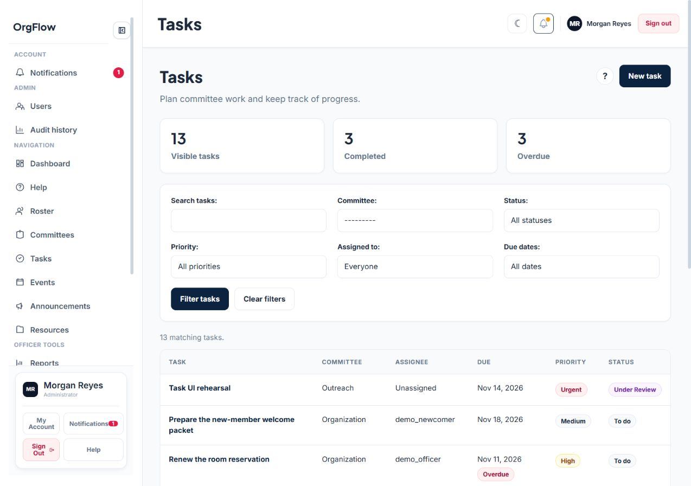
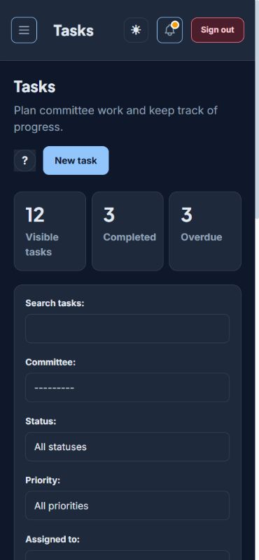

# Tasks UI refresh — November12

Updates the task list, create/edit form, detail/history page and approved-meeting
import page to match the shared UI from PR #50. Styles use the existing theme
variables and stay within the Tasks module. Other modules and shared styles are
unchanged.

The pages retain the existing fields, validation errors, CSRF tokens, version
fields, assignment loading/retry controls, filters, pagination and permission
conditions. Chair scope, member claiming/progress, Urgent, Under Review and
approved-action retry behavior are unchanged. This PR has no Python, JavaScript
or migration changes.

## Validation

- All **158 Tasks/Committees tests passed**, including Chair boundaries,
  claim/progress, stale forms, history and approved-action imports.
- Django system and migration checks passed; no model changes detected.
- Browser checks covered the task list at1280px in light mode, and task list,
  create form and detail at375px in dark mode. A synthetic Urgent task was created
  and moved to Under Review through the real forms. The mobile list and detail
  had no page overflow; the task table scrolls within its own region.
- The existing Django forms still render labels, help text, field errors and
  hidden versions. No new accessibility certification is claimed.

All browser data was synthetic in a separate local preview database. The user's
existing practice data and real providers were not used. Team review remains
pending; this is not a merge or deployment.

## Screenshots

Desktop, light theme:

Mobile, dark theme:

